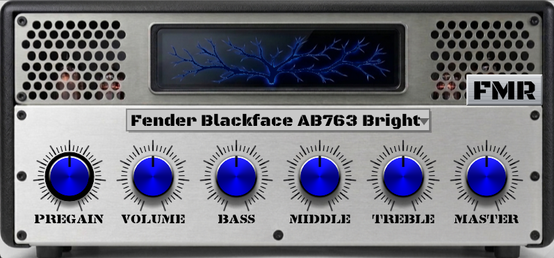
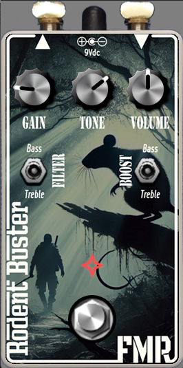
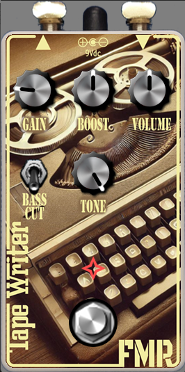

# FMR Labs

**Guitar tone, neural modeling, virtual analog.**
Free VST3 plugins for guitarists, built around small neural networks that run in real time.

> **Explore. Craft. Find. Enjoy your own sound!**

  
  
  

---

## What we build

FMR Labs is an independent audio research and development project. We model guitar amplifiers, pedals and effects as **lightweight neural networks**, and ship them as free Windows VST3 plugins:

* **Amplifiers and preamps**: from crystal-clear cleans to high-gain modern tones.
* **Drive and distortion pedals**: overdrives, distortions and boosts.
* **Dynamics, modulation and time effects**: tools tailored for guitar.

Browse the repositories of this organization for the current plugins and their downloads.

## How it works

| Block | Principle |
|---|---|
| **GRU neural network** | Each model is a small recurrent network (a GRU with 16 hidden units). It receives the input signal and the gain or drive setting, and outputs the processed signal sample by sample, so the response follows the knob instead of being a fixed snapshot. |
| **Training on circuits** | Networks are trained on simulations of the original circuits, over many input levels and control settings, at 48 kHz. |
| **Tone controls** | Each tone stack is measured as more than a thousand impulse responses, one per Bass, Middle and Treble combination. Every response is compared to the noon setting and reduced to a compact filter (a short cascade of biquads), then stored in a table sized for the best balance of precision and memory. At run time the plugin interpolates between table entries, so the knobs move the filter smoothly at a very low CPU cost. |
| **Light and real time** | A small network means low CPU use. The engine runs at 48 kHz, with automatic resampling for other host sample rates. |

## Good to know

> [!IMPORTANT]
> Amplifier and preamp plugins model **the preamp section only**. For a realistic guitar tone, place a **cabinet simulator / Impulse Response (IR) loader** right after them in your signal chain.

* **Platform:** Windows VST3 (64-bit). A Mac version is planned.
* **Price:** free. Use them in personal and commercial music productions.
* **Source code:** the iPlug2 wrapper and UI of the plugins are published here under the MIT License. The **audio engines and neural models are closed source** and not included, so the repositories cannot be compiled as they are.

## Support the project

If you enjoy these tools, you can support future development on **[Ko-fi](https://ko-fi.com/fmrlabs)**. Feedback and bug reports are welcome through the issues of each repository, or at FMRLabsVST@gmail.com.

---

## License and notices

* **Repository source code (iPlug2 UI and wrappers):** MIT License, see each repository.
* **Compiled binaries (`.vst3`):** freeware. You may use them in personal and commercial productions and redistribute the original, unmodified archive free of charge. Reverse engineering, decompiling, reselling, or redistributing modified binaries is prohibited.
* **Third-party components** (fonts, frameworks) keep their own licenses, listed in each repository and in the release archives.

*FMR Labs is an independent personal project and is not affiliated with FMR Audio.*
*VST is a trademark of Steinberg Media Technologies GmbH.*
*All amplifier, pedal and brand names are trademarks of their respective owners. They are used for identification purposes only; FMR Labs is not affiliated with, endorsed or sponsored by any of them.*
